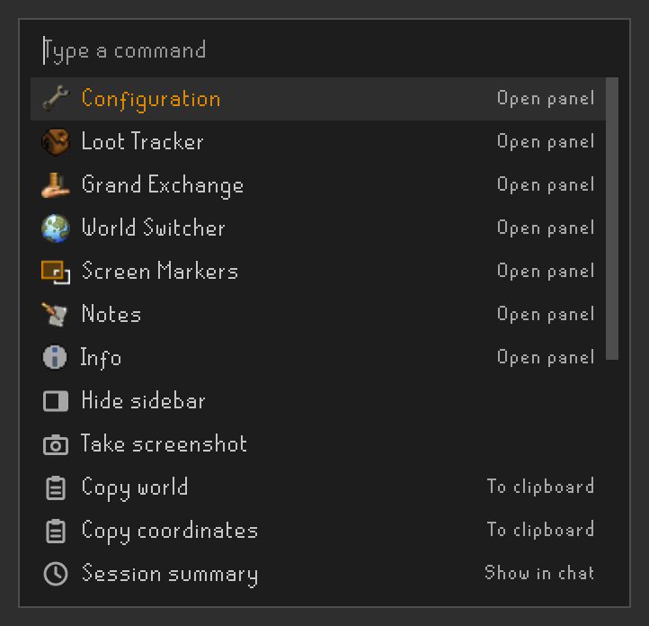
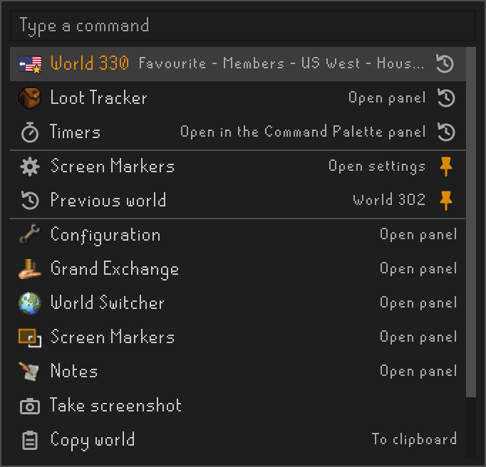
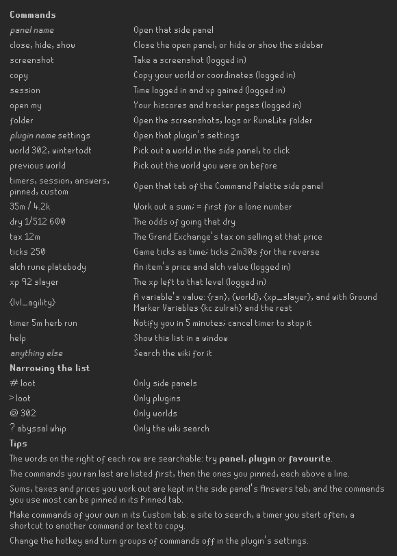
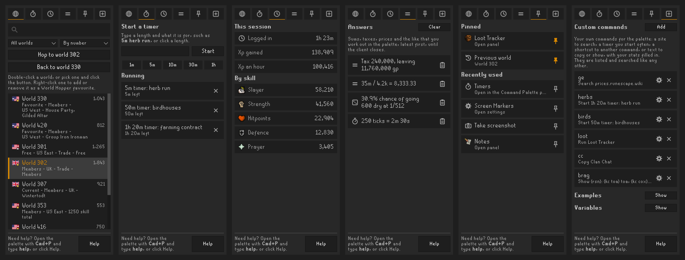
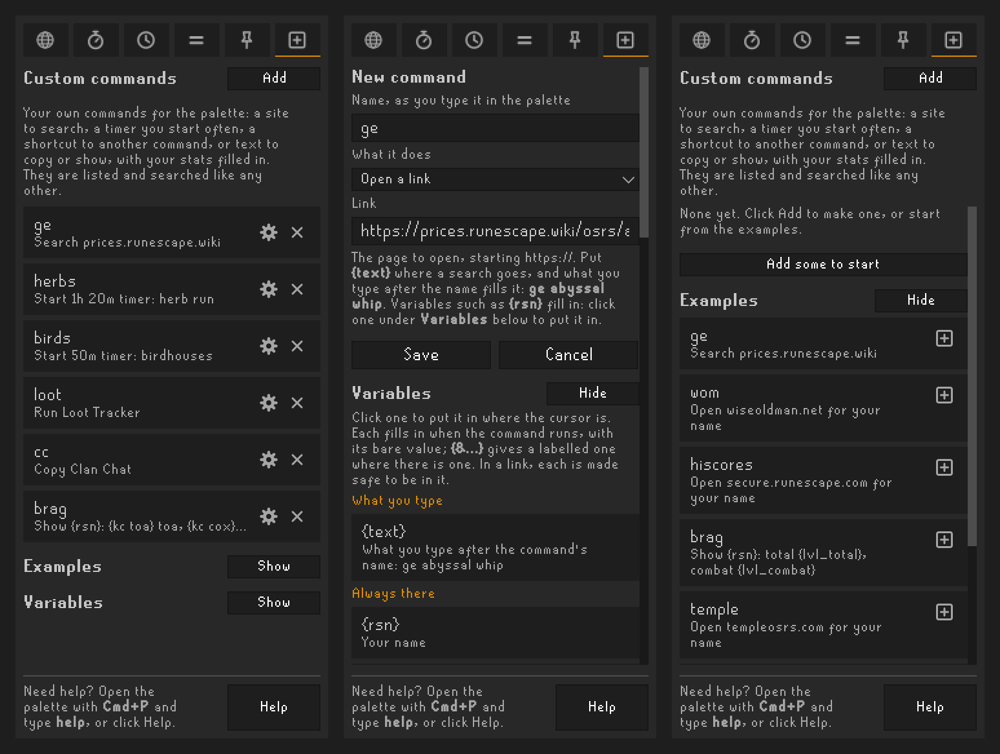

# Command Palette

A keyboard-driven list of commands for RuneLite. Press a hotkey, type a few letters, press `Enter`.

## Using it

Press **Cmd+P** (Mac) or **Ctrl+P** (Windows/Linux) anywhere in the client, including on the login screen and
while a side panel has the keyboard.

The plugin's settings have the key, **Open hotkey**, and whether Cmd or Ctrl has to be held with it, **Require
Ctrl/Cmd**. Only the key of the hotkey is used, so the same settings work on a Mac and on Windows. If the
Platform Keys plugin is on, its key profile decides which of Cmd and Ctrl it is. With Require Ctrl/Cmd off the
key opens the palette on its own, except while you are typing: in a text field, in the game's chat, or in one of
the game's input boxes such as the bank search. While the Key Remapping plugin keeps typing out of the chat until
`Enter`, the key opens the palette.

| Key | Action |
| --- | --- |
| Type | Filter commands; every word typed must match |
| `Up` / `Down`, `Tab` / `Shift+Tab` | Move the selection |
| `Page Up` / `Page Down` | Move a page at a time |
| `Enter` | Run the selected command |
| `Esc`, the hotkey again, or clicking elsewhere | Cancel |

The last eight commands you ran are listed first, latest first, in a section of their own: a line sets them
apart from the rest and each has a clock at the end of its row. **Recently used count** in the settings changes
how many, from 1 to 20. The section can be turned off there, and so can the icons. The commands you have
pinned in the side panel's Pinned tab come next, in a section of their own with a pin at the end of each row;
a pinned command stays in its section rather than moving up among the recently used. Once you type, the best
matches come first whichever section they were in, and they keep their clock or pin.

## Commands

Each group below has a switch in the plugin's settings. All of them start on except **Plugins on/off**.

### Side panels

| Command | What it does |
| --- | --- |
| *Panel name* - Open panel | Opens that side panel, reopening the sidebar if it is hidden. Listed in the sidebar's order. |
| Close side panel | Closes the panel that is showing |
| Hide sidebar / Show sidebar | Hides or shows the whole sidebar (needs RuneLite's custom title bar, which is on by default) |

### Client utilities

| Command | What it does |
| --- | --- |
| Take screenshot | Saves a screenshot of the game to your screenshots folder (logged in only) |
| Copy world, Copy coordinates | Copies your world number, or your tile as `x, y, plane`, to the clipboard (logged in only) |
| Session summary | Prints how long you have been logged in and the xp gained since, with the top three skills (logged in only) |
| Open my hiscores / Wise Old Man profile / collection log | Opens your page on the official hiscores, Wise Old Man or TempleOSRS in your browser (logged in only) |
| Open my group's hiscores | Opens your group's page on the group ironman hiscores (group ironmen only) |
| Open screenshots / logs / RuneLite folder | Opens that folder in your file manager |

### Lookups and sums

These are made from what you type, so they aren't in the list until you do.

| Type | What it does |
| --- | --- |
| `35m / 4.2k` | Works out the sum, with `k`, `m` and `b` amounts, `+ - * x /` and brackets. `Enter` copies the answer. Start with `=` for a lone number, as in `=2.5m`. |
| `dry 1/512 600` | Shows the chance of going 600 kills without a 1/512 drop, and the kills by which 50% and 90% of players have it. `Enter` copies the line. The kills can be left out, and `dry 512 600` means the same. |
| `tax 12m` | Shows the Grand Exchange's tax on selling one item at that price, 2% rounded down and at most 5m, and what is left. `Enter` copies the line. The price can be a sum, as in `tax 1.2b / 3`. The few items the Grand Exchange doesn't tax aren't known about. |
| `ticks 250` or `ticks 2m30s` | Converts game ticks of 0.6 seconds to time, or time to ticks. `Enter` copies the line. Time is written `90s`, `2m30s`, `1h 5m` or `1:30`. |
| `alch rune platebody` or `price ...` | Lists up to five matching tradeable items; running one prints its GE price and high alch value in chat (logged in only) |
| `xp 92 slayer` | Shows the xp you still need for that level, and prints it in chat. Leave the level out for your next one. (logged in only) |
| `{lvl_agility}` | Fills in a [variable](#variables) and shows its value; `Enter` copies it and keeps it in the Answers tab. Any text with variables works: `{rsn} is {lvl_total} total`. |

### Timers

| Type | What it does |
| --- | --- |
| `timer 5m herb run` | Starts a timer that says "Timer done: herb run" in chat when it runs out, and sends a RuneLite notification. The words after the time can be left out, and a number on its own is in minutes. |
| Cancel 5m timer: herb run | Listed while that timer is running, with the time left |

Timers go up to a day and are lost when the client closes. RuneLite's notifications are, unless you have changed
its settings, only sent while the client isn't the window in use; the chat message is there either way when you
are logged in.

### Worlds

| Command | What it does |
| --- | --- |
| World *number* | Looks up a world: type `world 302`, or part of an activity such as `wintertodt`, to see whether it is a members' world and what it is for. Running one opens the side panel's Worlds tab scrolled to that world and highlighted, ready to click. |
| Previous world | The world you were on before this one, picked out in the Worlds tab to hop back to |

The palette doesn't hop itself; Plugin Hub plugins may only hop from a click in a side panel, so the hop is left to
you in the [side panel](#the-side-panel). With the side panel turned off, running a world opens the World Hopper
plugin's panel instead. Each world's icon is the flag of where it is, with a gold star in the corner for a members'
world and a silver one for a free world, as in the game's own world switcher. A US world's flag has an arrow beside
it for its coast, as in the game: pointing right on red for the east coast and left on blue for the west, and every
world's description says where it is, such as `US West` or `Germany`, so `west` or `germany` finds them. The worlds
you have made favourites in the World Hopper plugin's panel come first and say `Favourite`, which finds just those.
The world you are on says `Current`. PvP, high risk, Deadman and beta worlds aren't listed.

### Plugins

| Command | What it does |
| --- | --- |
| *Plugin name* - Open settings | Opens that plugin's settings in the Configuration panel. Type `loot settings`. |
| *Plugin name* - Turn plugin on / off | Starts or stops that plugin. Off until **Plugins on/off** is turned on in the settings. |

Turning a plugin on or off asks for confirmation first; `Enter` confirms and `Esc` cancels. **Confirm plugins
on/off** in the settings turns that off. A plugin that conflicts with one that is currently on isn't offered;
turn it on from the Configuration panel, which asks before turning the other one off.

### Wiki search and help

| Command | What it does |
| --- | --- |
| Search the wiki for "..." | Always listed last once you have typed something; opens the OSRS Wiki's search for it in your browser |
| Help | Shows the commands that are turned on, with an example of each. The **Help** section of the settings points to it. |

## The side panel

The **Command Palette** panel in the sidebar keeps on screen what is better seen than typed, in six tabs. The
palette opens any of them: type `timers`, `session`, `answers`, `pinned` or `custom`. **Side panel** in the
settings removes it from the sidebar.

| Tab | What it has |
| --- | --- |
| Worlds | Every world the palette lists, with a search at the top and a choice of all, members' or free worlds, by number or by players. Click **Hop to world ...** or double-click a world to hop, and **Back to world ...** to return to the one before. Right-click a world to add it to the World Hopper plugin's favourites or take it out; that plugin's own panel shows the change the next time it reloads its list. |
| Timers | Start a timer by typing `5m herb run` or with one click on a length, and watch the ones running count down, each with a button to cancel it |
| Session | How long you have been logged in, the xp gained in all and an hour, and the xp in each skill, kept up to date while it is showing |
| Answers | The last 15 sums, taxes, prices, dry streaks and xp goals worked out in the palette, each with a button to copy it, until the client closes |
| Pinned | The commands you pin, a click away, and below them the ones you used recently, each with a pin to keep it |
| Custom | [Commands of your own](#custom-commands), to add, change and delete |

Nothing in the panel hops or acts on a key press: hopping takes a click.

### Custom commands

The Custom tab makes commands of your own out of what the palette can already do. Click **Add**, give the command
the name you will type, and choose what it does:

| Does | Example |
| --- | --- |
| Open a link | `ge` opening `https://prices.runescape.wiki/osrs/all-items?search={text}`: whatever you type after the name goes in place of `{text}`, so `ge abyssal whip` searches for the whip. A link without `{text}` just opens. |
| Start a timer | `herbs` starting `80m herb run` |
| Run a palette command | `loot` opening the Loot Tracker panel, or a plugin's settings, a world, a tab of the side panel |
| Copy text | `cc` copying your clan chat's name |
| Show text in the chat | `brag` showing `{rsn}: {kc toa} toa, {kc cox} cox` in the chat, where only you see it, and keeping it in the Answers tab |

Links, copied text and shown text can have [variables](#variables) in them, filled in when the command runs; in a
link each value is made safe for it, so `https://templeosrs.com/player/overview.php?player={rsn}` works. Copied
and shown text can take `{text}` as well.

The tab's **Variables** section lists every variable there is to use, with what each fills in: in the list,
clicking one copies it; in the editor, under **Save**, clicking one puts it in the link or text where the cursor
is.

A command that shows or copies text with variables in it says in the palette what it would give, filled in,
while you are logged in: `brag  Show Zezima: total 1,850, combat 110`.

With no commands yet, the tab offers examples to start from, such as `wom`, `hiscores` and `temple` opening those
sites' pages for your name, `brag`, and `ge` searching the Grand Exchange prices; **Add some to start** adds a
few. The examples stay listed under your own commands, behind **Show**.

Custom commands are listed, searched, remembered as recently used and pinned like any other. They are kept in each
RuneLite profile's settings. None of them can act on the game: they only do what the palette's own commands do,
and one can't run another.

### Variables

A variable is a name in braces that is filled in with what the client shows: `{rsn}`. The palette knows these by
itself:

| Variable | Filled in with |
| --- | --- |
| `{rsn}`, `{world}` | Your name and world (logged in) |
| `{time}`, `{time24}`, `{date}`, `{weekday}` | `8:21 pm`, `20:21`, `October 16th 2026`, `Friday` |
| `{lvl_agility}`, `{boost_agility}`, `{xp_agility}` | A skill's level, boosted level and xp, for any skill by name; `{lvl_total}` and `{lvl_combat}` too (logged in) |

With the [Ground Marker Variables](https://github.com/Limy-Monkey/Ground-Marker-Variables) plugin installed, every
variable it has works as well, asked of it through RuneLite's plugin messages: kill counts (`{kc zulrah}`),
personal bests, loot, your slayer task, special attack, items, sums of them (`{kc cox + kc cm}`) and
conditions. Each gives its bare value; write `{&kc zulrah}` for its labelled one, as that plugin shows on a tile: `{&loot Tombs of Amascut}` gives the kills, the gp and the best items, by name. A variable that can't be filled in is left as it was, braces and all. Reading a variable only reads what the
client already knows.

To keep lines with variables on screen, over the game, with alerts and their history, see the companion
**Variable Watch** plugin.

## Settings

| Setting | Default | What it does |
| --- | --- | --- |
| Open hotkey | `P` | The key that opens the palette. Only the key is used; the modifier comes from the next setting. |
| Require Ctrl/Cmd | On | Hold Cmd (Mac) or Ctrl (Windows/Linux) with the hotkey, or the Platform Keys plugin's choice when it is on |
| Recently used first | On | List the commands you ran last first, in a section of their own |
| Recently used count | 8 | How many of them, from 1 to 20 |
| Show icons | On | An icon before each command, and a clock after a recently used one or a pin after a pinned one |
| Side panel | On | The [Command Palette panel](#the-side-panel) in the sidebar |
| **Commands** | | |
| Side panels | On | A command per side panel, and ones to close the open panel and hide or show the sidebar |
| Client utilities | On | Screenshots, copying your world or coordinates, the session summary, your hiscores and tracker pages, and the screenshots, logs and RuneLite folders |
| Lookups and sums | On | Sums, dry streaks, the Grand Exchange's tax, ticks as time, item prices and xp to a level |
| Plugins on/off | Off | A command per plugin, to turn it on or off |
| Confirm plugins on/off | On | Ask before turning a plugin on or off |
| Plugin settings | On | A command per plugin with settings, to open them |
| Wiki search | On | Offer a wiki search for whatever is typed. Starting with `?` searches the wiki either way. |
| Worlds | On | A command per world, to pick it out in the side panel |
| Timers | On | `timer 5m herb run`. A running timer can be cancelled either way. |

## Requirements

Nothing beyond RuneLite. The worlds you have made favourites in RuneLite's World Hopper plugin come first, whether
or not that plugin is on, and the Platform Keys plugin, when it is on, decides between Cmd and Ctrl.

The first time you log in after installing it, the plugin says in the chat which key opens the palette. After an
update that adds something worth knowing, it says what, once, the next time you log in.

## Finding a command

The words on the right of each row are searchable too: `panel` lists only the panels, and `loot settings` finds
"Loot Tracker - Open settings".

Start the search with a symbol to narrow the list:

| Symbol | Lists only |
| --- | --- |
| `#` | Side panels |
| `>` | Plugins |
| `@` | Worlds, as in `@302` |
| `?` | The wiki search, as in `?abyssal whip` |

## Adding a command

A command is a `Command`: a title, a line of detail, an optional 16x16 icon and a `Runnable`, which runs on the
Swing thread after the palette has closed. `SidebarCommands` and `PluginCommands` each add a batch of them to the
list in `CommandPalettePlugin.open()`; a new group goes alongside them, with a setting in `CommandPaletteConfig`.
A command made from what is typed, like `tax 12m`, goes in `TypedCommands.forQuery()` instead. Either way, add a
row for it to `HelpCommand`.

## How panels are opened

RuneLite's API can open a panel only for the plugin that owns it, so this plugin works on the client window's
Swing components instead (see `Sidebar`): the sidebar is a tabbed pane with a tab per panel, and selecting a tab
is what clicking its icon does. No reflection is involved.

## Development

`./gradlew runClient` starts RuneLite with the plugin loaded. `./gradlew test` also renders the pictures in this
README: the animation to `build/demo.gif`, the help window to `build/help.png`, and the palette, the side panel and
its Custom tab to `build/docs/`. Copy them into `docs/` after changing how any of them looks.
It writes a sheet of the palette's looks to `build/preview.png` too, for checking them at a glance.
